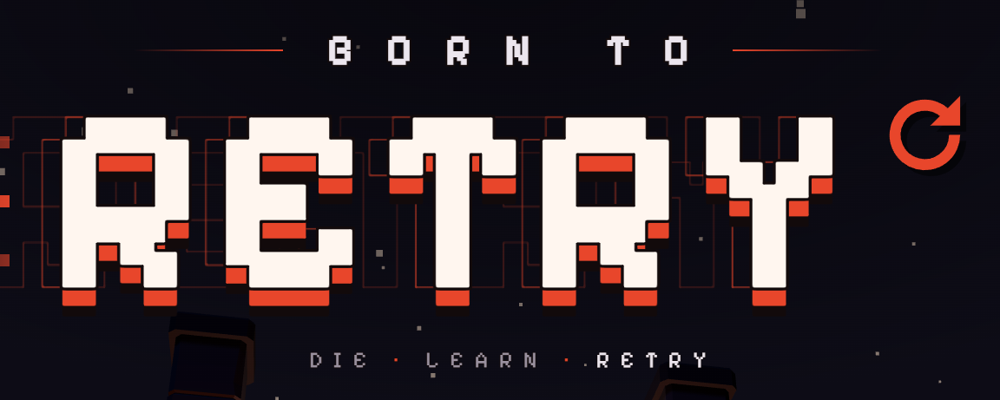
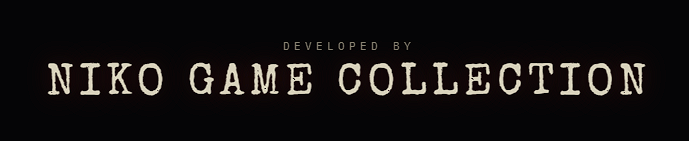

<p align="center">
  
</p>

<p align="center">
  <strong>A first-person action roguelike for the desktop browser.</strong>
</p>

<p align="center">
  
  
  
  
</p>

---

## About

**Born To Retry** is a fast, hard, single-player roguelike played in first person. Every run starts with bare hands and
nine floors to fight through, each with its own enemies and its own boss. Weapons break, healing is scarce, and on the
standard difficulty you get one life. Losing is part of the design: play, lose, learn, retry.

> **Status:** pre-release and in active development. Floors 1 to 9 are playable in a run; floor 10 is still being built.

## Features

- **Fast movement.** Dash, wall run, wall jump and ground pound through rooms that lock behind you.
- **Fists first.** Every run opens with jab combos and a parry. Anything else you have to find or buy.
- **Weapons that break.** Eight weapons, from swords and hammers to daggers and a grimoire. Throw one at any time; a
  broken one is thrown for a big hit.
- **Executions.** Kills fill a meter. When it's full, grab a nearby enemy and finish it to win back health. Hits and
  kills heal nothing: health comes from hearts, rings and executions.
- **Cards that change the run.** Boss and challenge-room chests deal from a deck of 69 cards, and not all of them are on
  your side. Gravity Sean has 40 of his own, in place of weapons.
- **A new layout every run.** Hand-made rooms assembled from a seed, with a shop and an optional challenge room on every
  floor.
- **A manor between runs.** Walk the lobby to pick your difficulty, browse galleries of the weapons, items and cards, and
  visit the bestiary.

### Floors

| # | Floor | Boss |
|---|---|---|
| 1 | The Dungeon | The Dragon |
| 2 | The Venom Garden | The Swarm |
| 3 | The Bone Keep | The Bone King |
| 4 | Frozen Depths | The Frost Roc |
| 5 | The Drowned Temple | The Drowned King |
| 6 | The Desert | The Velociraptor |
| 7 | Skull Cove | The Big Shark |
| 8 | The Shrine Dimension | Yokai: Okami |
| 9 | The Moon | Tidebreaker |
| 10 | Hell on Earth | *In development (dev builds only)* |

### Difficulties

| Difficulty | Rules |
|---|---|
| WEAKLING EXPERIENCE | A death sends you back to your checkpoint with everything you carry. |
| THE REAL EXPERIENCE | One life. |
| ARE YOU EVEN HUMAN? | One life and fists only: no coins, weapons, keys, chests, shop or rewards. |

## Controls

Keyboard and mouse. Every action can be rebound in the options, except Esc.

| Input | Action |
|---|---|
| `W` `A` `S` `D` | Move |
| Mouse | Look |
| `Space` | Jump, wall jump |
| `Shift` | Dash |
| `Ctrl` | Ground pound (in the air) |
| Left click | Attack |
| Right click | Parry with bare hands, a weapon's alternate attack otherwise |
| `Q` | Throw the held weapon |
| `E` | Interact, execute |
| `1` to `5` | Weapon slots (`1` is your fists) |
| Mouse wheel down | Switch key at a chest |
| `Tab` | Inventory |
| `F2` | Show the frame rate |
| `Esc` | Pause |

## Getting started

**Requirements:** [Node.js](https://nodejs.org) 24 (see `game/.nvmrc`) and a desktop browser with WebGL 2. Chrome or Edge
is recommended: only Chromium browsers can hand keys like `Ctrl+W` to the game in fullscreen.

On Windows, run `START_GAME.bat`. It installs the dependencies on the first run and starts the game. Anywhere else:

```bash
cd game
npm install
npm run dev
```

The game opens at `http://localhost:5173`.

### Commands

Run these from `game/`.

| Command | What it does |
|---|---|
| `npm run dev` | Starts the dev server, with the dev tools on |
| `npm run build` | Type checks, then builds the public version into `game/dist` |
| `npm run preview` | Serves the public build locally |
| `npm test` | Runs the rule tests |
| `npm run verify:quick` | Type check and rule tests |
| `npm run verify` | Type check, rule tests and production build |

### Dev tools

Available only from the dev server. `npm run build` turns them off.

| Key | Tool |
|---|---|
| `F1` or `` ` `` | Tuning panel: every feel number, live |
| `F2` | Debug overlay |
| `F3` | Respawn enemies |
| `F4` | Invincibility |
| `F7` or `\` | Capture kit, for trailer footage |
| `F8` | Lab panel, including floor 10 |
| `F9` | Feel Lab |

### Deployment

`npm run build` produces a static site in `game/dist`. Deploy it at the **root** of a host, such as Netlify. Models load
from absolute `/models/...` paths, so a host that serves from a subfolder (itch.io, for example) needs relative paths
first.

## Technology

| Area | Choice |
|---|---|
| Language | TypeScript (strict) |
| Rendering | [three.js](https://threejs.org) 0.186 |
| Collision | [Rapier](https://rapier.rs) 0.21 |
| Menus and HUD | [React](https://react.dev) 18 |
| Build | [Vite](https://vite.dev) 5 |
| Audio | Web Audio: recorded samples and code-made synths |
| Saves | Browser `localStorage` |
| Asset pipeline | Headless [Blender](https://www.blender.org) 5.0 scripts; Python for cutting sound clips |

The main design rules:

- **Pure game rules.** `sim/`, `world/`, `tuning/` and `state/` don't touch React, the DOM or Rapier, so the rules can be
  tested without a browser.
- **Fixed-step simulation.** The game runs at 120 ticks a second with interpolated rendering. Mouse look is applied on
  every rendered frame.
- **Seeded runs.** All run randomness goes through one seeded generator, so a seed gives the same run.
- **Nothing hard-coded for feel.** Speeds, timings, forces and hit-stop live in `tuning/` and can be changed live from
  the tuning panel.

### Project structure

```text
.
├── START_GAME.bat       Starts the dev server (Windows)
├── DEVELOPMENT.md       Which module owns what
├── HANDOVER.md          Current state and next steps
├── MD/                  Game design, floor plans, asset pipelines
├── MD_UPDATES/          Plans and specs for each update
└── game/
    ├── public/          Shipped models, sounds and music
    ├── src/
    │   ├── audio/       Web Audio buses, samples and synths
    │   ├── core/        Fixed-step clock, frame stats, seeded RNG
    │   ├── engine/      three.js: scenes, camera, first-person arms, effects
    │   ├── input/       Keyboard, mouse and rebinding
    │   ├── physics/     Rapier collision
    │   ├── platform/    Pointer lock, fullscreen, leave-page guard
    │   ├── screens/     React menus, HUD and tuning panel
    │   ├── sim/         Rules: player, combat, enemies, weapons, cards, rooms
    │   ├── state/       Saves and settings
    │   ├── tuning/      Every feel number, with its range and description
    │   ├── ui/          CSS theme
    │   └── world/       Floors, room layouts and the lobby
    ├── tests/           A test script per feature
    ├── tools/           Blender, audio and screenshot tools
    └── verify.mjs       Type check, tests and build
```

### Documentation

| Document | Contents |
|---|---|
| [`MD/DESIGN.md`](MD/DESIGN.md) | The full game design |
| [`DEVELOPMENT.md`](DEVELOPMENT.md) | The module map |
| [`HANDOVER.md`](HANDOVER.md) | Where things stand and what's next |
| [`MD_UPDATES/`](MD_UPDATES) | The plan or spec behind each update |

## Playtest feedback

In a run, press `Esc` and choose **Feedback**. Write about cards, level design, enemies, difficulty or ideas, then press
**Copy** and paste the text wherever you were asked to send it. The copy includes the game's version, your average frame
rate, and your frame cap, glow and effects settings.

The game has no accounts, no analytics and no online features. It downloads only its own files and two interface fonts
from Google Fonts, and saves stay in your browser.

## Roadmap

- Floor 10, Hell on Earth: its own enemies and its boss, Hellwarden
- The rest of The Swarm's attacks and phases
- Cinematic intros for the remaining bosses
- A Steam release, through Electron

## Credits

**Models and animation:** [Quaternius](https://quaternius.com): Modular Dungeon Pack, Ultimate Nature Pack, Ultimate RPG
Pack, Ultimate Monsters, Pirate Kit, Ultimate Space Kit, Bestiary: Dungeon Monsters Kit, Universal Animation Library 1
and 2, and further character and nature models. Released under
[CC0](https://creativecommons.org/publicdomain/zero/1.0/) or the
[Quaternius Asset License](https://quaternius.com/license.html).

**Sound effects:** [Sonniss #GameAudioGDC 2026](https://sonniss.com): libraries by 344 Audio, Alexander
Kopeikin, Cinematic Sound Design, David Dumais Audio, Epic Stock Media, Federico Soler, InMotionAudio, Ivo Vicic,
Jake Fielding, SoundBits and The Noisery. Other sounds are made in code.

**Fight music:** Polarnyne (Izakaya Funes' Metal Pack) and Intersonic Sound (Replica · Extreme Cyber Metal).

## Licence

© 2026 Niko Game Collection. All rights reserved.

The source code and original content in this repository are proprietary. No licence to use, copy or redistribute them is
granted. Third-party assets in `game/public/` are not covered by this notice: they stay under their own licences (see
[Credits](#credits)), some of which forbid redistributing them as assets.

<p align="center">
  
</p>
